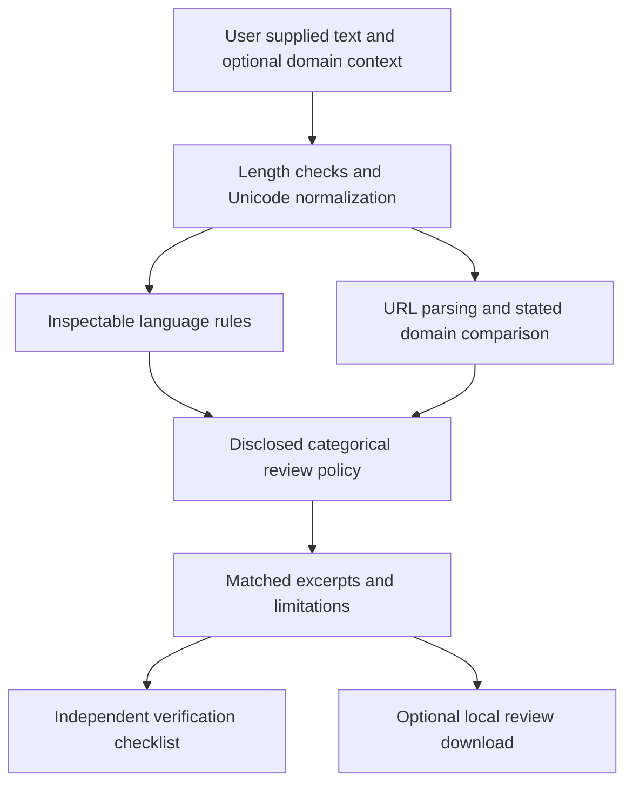

# Architecture and scope

The current demonstrator processes plain message text entirely in the browser. The loopback server only serves allowlisted static files. No model, account, mailbox, external lookup, telemetry or stored message database is used. Downloading a review is an explicit user action and can retain sensitive excerpts on that user's device.

The proposed research system would add a manipulation classifier and separately validated context handling. The source concept also proposes behavioural panic detection, a message sanitiser and graded intervention. Those capabilities are absent from the current executable. A future audit design needs minimized retention, access control and integrity requirements. The current JSON download is a user-held record, not an authenticated audit log.

## Threat assumptions

Message text and instructions embedded within it are untrusted. The prototype displays results as text, leaves source messages unchanged and never visits extracted URLs. A domain field is supplied by the user and cannot authenticate an email. HTML/script content in a message must remain inert. Normalizing selected zero-width and compatibility characters addresses only some evasion methods. The browser, operating system and local files are trusted. Compromised hosts/extensions, homograph detection in full, attachments, QR codes, audio, images and real-time mailbox monitoring are outside scope.

## Source concept flow

The source describes Pass, Annotate, Soften and Hold-and-verify. Their numerical thresholds and exact implementation were not recoverable. These are retained as conceptual labels rather than operational policies. The revised demonstration never edits a command or grants operational clearance. High urgency alone must not suppress a legitimate safety instruction. A future system would need independent authentication and an approved response procedure before any live intervention.
